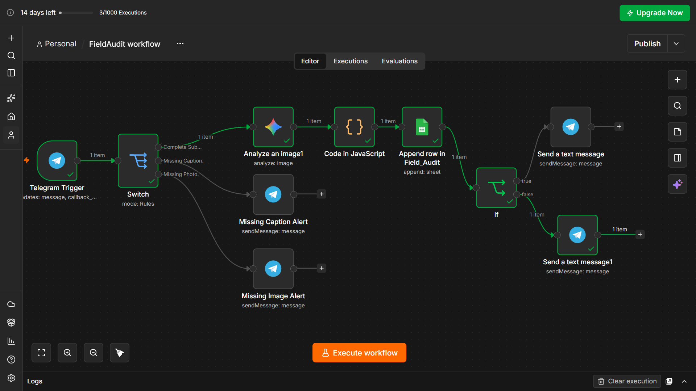
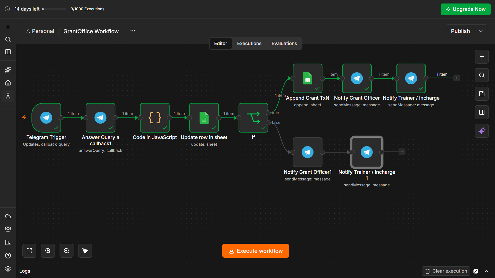

# NGO Field Audit Verification & Grant Approval Automation

> An AI-assisted audit workflow that processes NGO field evidence, uses Gemini to analyze submitted images, records structured audit results, and routes grant decisions through a human approval workflow.

## 🎯 Business Problem

NGO field audits can involve collecting field evidence, checking whether submissions contain the required information, comparing reported attendance with visual evidence, recording audit results, and obtaining an authorized decision before grant funds are released.

The goal of this system is to reduce repetitive manual processing while keeping the final funding decision under human control.

The system is split into two n8n workflows:

1. **Field Audit Workflow** — receives field evidence, validates the submission, analyzes the image with Gemini, processes the result with JavaScript, and records the audit.
2. **Grant Office Workflow** — receives the grant officer's decision, updates the audit record, records an approved transaction when applicable, and sends notifications.

## 🏗️ Architecture

```text
                    NGO FIELD AUDIT SYSTEM

        ┌──────────────────────────────┐
        │       Field Submission       │
        │          Telegram            │
        └──────────────┬───────────────┘
                       │
                       ▼
              ┌─────────────────┐
              │ Field Audit     │
              │ Workflow        │
              └────────┬────────┘
                       │
          ┌────────────┼────────────┐
          │            │            │
          ▼            ▼            ▼
    Missing Caption  Gemini      Missing Photo
       Alert        Analysis        Alert
                       │
                       ▼
                JavaScript
              Data Processing
                       │
                       ▼
                Google Sheets
                 Field_Audits
                       │
                       ▼
                AI Verification
                 /          \
                /            \
             Verified      Anomaly
                │             │
                ▼             ▼
          Grant Officer  Manual Review
             Decision       Required
                │             │
                └──────┬──────┘
                       ▼
              Grant Office Workflow
                       │
                  ┌────┴────┐
                  │         │
              Approved   Rejected/Held
                  │         │
                  ▼         ▼
          Grant Transaction  Notification
                  │
                  ▼
        Trainer / In-charge Notification
```

### Field Audit Workflow



Detailed technical architecture: [`architecture/architecture.md`](architecture/architecture.md)

The field workflow validates whether a Telegram submission contains both a photo and caption. Complete submissions are sent to Gemini for image analysis. The returned result is parsed and normalized with JavaScript before being stored in the `Field_Audits` sheet. fileciteturn3file1L674-L765 fileciteturn3file1L824-L854

### Grant Office Workflow



The grant workflow receives a Telegram callback from the reviewer, parses the decision and audit information with JavaScript, updates the audit record, and conditionally creates a grant transaction for approved decisions. It then sends status notifications to the relevant participants. fileciteturn3file0L35-L70 fileciteturn3file0L243-L305 fileciteturn3file0L410-L507

## ⚙️ How It Works

### 1. Field submission

A field trainer sends a Telegram message containing the field photo and supporting caption.

The workflow checks the submission:

- Photo + caption → continue to verification
- Photo without caption → request missing field notes
- Text without photo → request visual evidence

The routing logic is implemented with an n8n Switch node. fileciteturn3file1L674-L755

### 2. AI-assisted image verification

Gemini receives the uploaded image and the claimed attendance information. The prompt asks the model to return structured JSON containing the visible count, claimed count, discrepancy status, confidence score, and audit reasoning. fileciteturn3file1L1118-L1145

### 3. Custom JavaScript processing

A JavaScript Code node:

- Extracts the claimed count from the caption
- Parses the Gemini response
- Compares claimed and observed headcount
- Determines the audit status
- Generates an audit ID
- Maps program tags to grant IDs
- Creates the structured record for the audit sheet

This keeps the business logic explicit rather than relying entirely on the LLM output. fileciteturn3file1L763-L775

### 4. Structured audit record

The processed result is appended to the `Field_Audits` sheet with fields such as:

- Audit ID
- Timestamp
- Program
- Grant ID
- Claimed headcount
- Observed headcount
- Equipment detection
- AI status
- Discrepancy summary
- Human decision
- Reviewer timestamp

fileciteturn3file1L824-L854

### 5. Human-in-the-loop approval

The system does not automatically release funds based only on the AI result.

For a verified submission, the grant officer receives actions to:

- **Confirm & Release Funds**
- **Hold for Manual Audit**

For an anomalous submission, the reviewer can:

- **Override & Release**
- **Reject Claim**

These decisions are sent back to the Grant Office workflow through Telegram callback actions. fileciteturn3file1L1024-L1109

### 6. Grant transaction and notifications

The Grant Office workflow updates the audit record. When a decision results in approval, it appends a transaction to `Grant_Transactions` with the grant ID, audit ID, approval timestamp, authorized amount, transaction ID, reviewer, and documentation status. fileciteturn3file0L243-L305

The workflow then sends Telegram notifications for the outcome, including approval/disbursement or rejection/hold states. fileciteturn3file0L410-L507

## 👨‍💻 My Contribution

I designed and built the workflow architecture in n8n, including the field-submission validation, AI image-analysis integration, JavaScript data-processing logic, Google Sheets integration, Telegram notification flows, and human approval process.

I also separated the process into two workflows so that field verification and grant-office decision handling remain independently manageable.

## 🧰 Tech Stack

- **n8n** — workflow orchestration
- **Google Gemini** — AI image analysis
- **JavaScript** — custom data processing and business logic
- **Telegram** — field submission, review actions, and notifications
- **Google Sheets** — audit and transaction records
- **Human-in-the-loop approval** — final grant decision

## 📊 Result

The system converts a multi-step field-audit and grant-review process into a structured automation pipeline:

```text
Field Evidence
      ↓
Submission Validation
      ↓
AI Image Analysis
      ↓
JavaScript Processing
      ↓
Structured Audit Record
      ↓
Human Review
      ↓
Grant Decision
      ↓
Transaction / Notification
```

The important design principle is that **AI assists with verification, while a human reviewer remains responsible for the final funding decision**.

## 🎥 Demo

**Loom:** Add demo link here

For the demonstration, show both workflows and one complete example from field submission through reviewer decision.

## 📂 Repository Structure

```text
ngo-field-audit-automation/
├── README.md
├── .gitignore
├── architecture/
│   ├── architecture.md
│   ├── field-audit-workflow.png
│   └── grant-office-workflow.png
├── docs/
│   └── setup.md
├── examples/
│   └── sample-flow.md
└── workflows/
    ├── field-audit-workflow.json
    └── grant-office-workflow.json
```

## 🚀 Setup

1. Import both workflow JSON files into an n8n instance.
2. Configure credentials for Telegram, Google Sheets, and Google Gemini.
3. Create/configure the required Google Sheets structure.
4. Update the placeholder Google Sheet ID in the workflow configuration.
5. Configure the Telegram bots and chat IDs for your own environment.
6. Test the field submission workflow with a sample image and caption.
7. Test both the verified and anomaly paths.
8. Test the Grant Office approval/rejection callbacks.
9. Activate the workflows after validation.

The exported JSON files in this repository are **sanitized examples** and are not ready to run without configuring your own credentials and environment values.

## 🔐 Security

The workflow exports have been sanitized for public sharing.

Do **not** commit:

- API keys
- OAuth tokens
- Telegram bot tokens
- Telegram chat IDs
- Google Sheet IDs belonging to private data
- Private webhook URLs
- Personal information
- `.env` files

## 📄 Workflow Files

- [`Field Audit Workflow`](workflows/field-audit-workflow.json)
- [`Grant Office Workflow`](workflows/grant-office-workflow.json)

---

Built as an AI automation project demonstrating how LLM-based image analysis, custom code, workflow orchestration, and human approval can work together in a business process.
